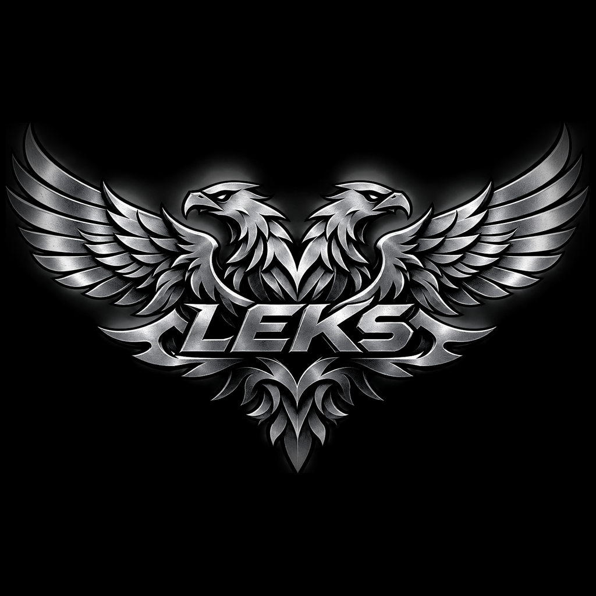

<p align="center">
  
</p>

<h1 align="center">Лексика — язык программирования на русском языке</h1>

<p align="center">
  <b>Лексика</b> (лексик, лекс, Лексика) — язык программирования, целиком построенный на русском языке.<br>
  <b>Лексус</b> — развиваемый движок и набор инструментов языка; полный нативный рантайм ещё находится в разработке.<br>
  Исходники языка лежат в файлах <b><code>.lek</code></b>. Команда — <code>лексус</code>.
</p>

<p align="center">
  <a href="#установка"></a>
  <a href="#установка"></a>
  
  
  
  <a href="LICENSE"></a>
</p>

---


<p align="center">
  <a href="https://zmlsaggg.github.io/Leksika/">Сайт проекта</a> ·
  <a href="https://zmlsaggg.github.io/Leksika/playground.html">Попробовать код в браузере</a> ·
  <a href="https://github.com/zmlsaggg/Leksika">Публичный репозиторий</a>
</p>

<p align="center">
  <a href="README.en.md">English overview</a> ·
  <a href="LICENSE">MIT License</a> ·
  <a href="SECURITY.md">Сообщить об уязвимости</a> ·
  <a href="CONTRIBUTING.md">Участие в разработке</a> ·
  <a href="CHANGELOG.md">История изменений</a> ·
  <a href="RELEASING.md">Выпуск релизов</a>
</p>

<p align="center">
  <a href="LICENSE">MIT License</a> ·
  <a href="SECURITY.md">Сообщить об уязвимости</a> ·
  <a href="CONTRIBUTING.md">Участие в разработке</a> ·
  <a href="CHANGELOG.md">История изменений</a>
</p>

> **Статус разработки:** проект активно развивается. Возможности, перечисленные ниже, имеют разную степень готовности; ограничения текущего движка и переходного рантайма указаны отдельно. Не все компоненты уже доступны в стабильной сборке.


## Нативное ядро и VM

Добавлен первый регистровый bootstrap-модуль виртуальной машины: собственные значения, компактный байткод, верификатор, арифметика, переходы и лимит исполнения. Он пока не подключён к основному парсеру и не заменяет Python-интерпретатор. Подробности: [архитектура нативного движка](документы/АРХИТЕКТУРА_НАТИВНОГО_ДВИЖКА.md).

## Нативная лексическая база

Русские словоформы готовятся нативным C11-bootstrap-сборщиком из закреплённого MIT-источника. В установщик включается готовый бинарный индекс LEKSLXD1; нативный лексический анализатор и команды ядра выполняют поиск и префиксные подсказки без Python, CP1251 и сетевой загрузки словаря. Полная генерация и проверка индекса на всём наборе из 1,5 млн записей остаётся обязательным шагом сборки. Инструкция: [сборка встроенного словаря](документы/СБОРКА_ВСТРОЕННОГО_СЛОВАРЯ.md).

## Онлайн-песочница

Учебное подмножество Лексики можно запускать прямо в браузере, без скачивания.
Песочница включает редактор, примеры и вывод ошибок. Это отдельная облегчённая
машина, а не полный настольный Лексус. ИИ-помощник включён по умолчанию: можно
загрузить совместимую модель Hugging Face и запускать её локально в браузере через
WebGPU/WebAssembly либо подключить внешний API. Доступны строгий, сбалансированный
и креативный стили. Подробности: [документация песочницы](документы/ОНЛАЙН_ПЕСОЧНИЦА.md).

## Коротко

**Лексика** — русский язык программирования с двумя формами записи:
словесной и совместимой. В обеих ключевые слова и имена остаются русскими.
В совместимой форме можно использовать знакомые блоки по отступам или в
фигурных скобках, `()`, математические знаки и точку с запятой. Смысл слова
по-прежнему задаётся **падежом**, а совместимый слой переводит привычную
пунктуацию в общую грамматику языка.

```лексика
пусть сумма равно пяти.
положить десять в сумму.
прибавить два к сумме.
сказать речь Сумма равна (сумма) конец речи.
```

```
Сумма равна 12
```

Лексика предназначена для экспериментов с русскоязычным синтаксисом, морфологией и альтернативным устройством языков программирования.

## Что это такое и чем не является

| Вопрос | Ответ |
|---|---|
| Язык программирования на русском языке? | Да, весь синтаксис русский, без латиницы. |
| Является ли движок независимым от Python? | Пока нет. Синтаксис и правила языка собственные, но текущая реализация Лексуса исполняется средой Python 3.8+. |
| Расширение исходников? | `.lek` — собственный формат программ Лексики. |
| На чём написан текущий движок? | Переходные внутренние модули `лексика/*.lek` пока содержат Python-код и запускаются через Python. Мы переносим их на собственный движок; это не скрывается за расширением файла. |
| Нужны ли сторонние библиотеки? | Для базового режима нет: достаточно стандартной библиотеки Python 3.8+. |
| Нужен ли интернет? | Нет. Встроенная модель русского языка лежит внутри движка. |
| Можно ли писать без латиницы целиком? | Да, и в коде, и в именах, и в командной строке. |

## Совместимая форма синтаксиса

Можно писать привычными структурными конструкциями, не переходя на английский
язык:

```text
целое сумма(целое первое, целое второе) {
    вернуть(первое + второе);
}

если (сумма(2, 3) >= 5) {
    сказать(речь Всё получилось конец речи);
}
```

Поддерживаются базовые формы блоков из Python и семейства C, круглые скобки,
операторы и перечни в квадратных скобках. Это не полный парсер Python или C++:
их ключевые слова, латинские имена, классы, шаблоны и специфичные конструкции
не принимаются. Подробности — в
[руководстве по совместимому синтаксису](документы/СОВМЕСТИМЫЙ_СИНТАКСИС.md).

## Возможности

* **Русское письмо.** Русские ключевые слова и имена; базовая форма остаётся
  словесной, а совместимая добавляет круглые скобки, фигурные блоки, отступы
  и привычные знаки выражений. Латинские идентификаторы не принимаются.
* **Падежное управление.** Падеж говорит движку, что означает слово:
  `положить в сумму`, `прибавить к сумме`, `умножить сумму на два`.
* **Морфология с нуля.** Склонение существительных, спряжение глаголов, беглые
  гласные, множественное число: `перечень → перечня`, `покупки → покупок`.
* **Числа словами.** `сорок два`, `две тысячи пятьсот`, дробь словом `запятая`.
* **Замыслы.** `если … то … иначе`, `пока … повторять`, `для каждого … из`,
  `повторить три раза`, `прервать`, `продолжить`.
* **Правила.** Свои действия с параметрами, возвратом значения, вложенностью и
  рекурсией: `правило факториал принимает число повторять … конец правила.`
* **Перечни и словари.** Встроенные `перечень()`, `словарь()`, чтение и запись по
  ключу, `длина`, `подключить числа.`
* **Заплатки.** Своя упаковка программы в `.патч`: `собрать`, `наложить`,
  `откатить`, `запустить`. Свой контейнер, свой отпечаток, свой список.
* **Разум языка.** Своя крошечная нейронная сеть на падежи, число и род: 580 КБ,
  обучается своим скриптом, работает без сети и без чужих библиотек.
* **Переходная машина.** Есть сборка части операторов в команды и прототип исполнения,
  но выражения и часть вызовов ещё делегируются старому исполнителю. Полная VM без Python —
  отдельный обязательный этап, описанный в контракте движка.
* **Собственная модель значений (первый этап).** В загрузочном ядре уже есть
  отдельные значения Лексики, точные десятичные числа, UTF-8-речь, перечни и словари.
  Модуль имеет собственные проверки, но пока не подключён к исполнению `.lek`.
* **Защищённый режим.** В отдельной политике можно запретить сеть, внешние процессы,
  сторонние Python-модули и файловый доступ вне разрешённых корней. Есть
  SHA-256-цепочка локального аудита и переходный доступ к секретам без вывода их значений.
* **Корпоративный TLS-инструментарий (необязательно).** Отдельная команда
  проверяет X.509-цепочки, контейнеры PKCS#12 и mTLS-подключения. Основное ядро
  не зависит от OpenSSL; ГОСТ TLS остаётся интеграцией через внешний криптопровайдер.
* **Установщики.** `.exe` для Windows со встроенным Python и установщик
  для Linux и macOS. Текущий движок требует Python; нативная замена рантайма ещё не реализована.
* **Свой загрузчик частей.** Движок сам находит файлы `.lek`, собирает их в
  байт-код и исполняет — без стороннего механизма импорта.
* **Проверки.** 100 проверок языка и прогон всех примеров из документации.

## Банки и государственные интеграции

Для диагностики корпоративных TLS-соединений есть отдельный необязательный
инструмент `лексус-сертификаты`. Он умеет читать X.509 PEM/DER, проверять
цепочку доверия, проверять клиентский PKCS#12 и выполнять TLS-проверку с
проверкой имени узла и mTLS. OpenSSL 3 нужен только для этой цели:

```sh
make -C ядро tls-tools
make -C ядро tls-test
./ядро/лексус-сертификаты профили
```

Сертификаты НУЦ Минцифры скачиваются только с
[официальной страницы Госуслуг](https://www.gosuslugi.ru/crt). Для Sber API
можно проверить контейнер `.p12` и выполнить mTLS-подключение. ГОСТ TLS
не реализуется собственными алгоритмами: для него требуется штатный внешний
сертифицированный криптопровайдер и совместимый сетевой стек. Инструмент
не устанавливает корневые CA в системное хранилище.

Полные инструкции, ограничения и примеры — в
[документе корпоративного TLS](документы/КОРПОРАТИВНЫЙ_TLS.md).

## Корпоративная защита и offline-first

Для банковских, государственных и внутренних корпоративных программ появился
отдельный слой политики безопасности:

    лексус безопасность
    лексус безопасность режим защищённый
    лексус безопасность путь ~/Проекты/Банк/приложение
    лексус безопасность аудит
    лексус секрет СБЕР_ПАРОЛЬ

В защищённом режиме по умолчанию закрыты сеть, внешние процессы, сторонние
Python-модули и файловый доступ вне разрешённых корней. Секреты доступны
только по имени из allowlist и не попадают в аудит.

DuckDuckGo больше не является частью ядра: это отдельный необязательный
провайдер. Внешние модели остаются локальными по пути; доступ к сторонним
Python-модулям требует отдельного разрешения.

Полная схема — [политика безопасности](документы/ПОЛИТИКА_БЕЗОПАСНОСТИ.md).
Полная ревизия внешних серверов и Python-зависимостей —
[ревизия зависимостей](документы/РЕВИЗИЯ_ЗАВИСИМОСТЕЙ.md).

## Нативное ядро Лексуса

В каталоге `ядро/` находятся загрузочные нативные модули на C11:
анализ UTF-8 и исходного текста, начальная морфология и отдельная модель
значений Лексики с точной десятичной арифметикой. Они собираются отдельно.
Модель значений пока не подключена к компилятору или VM:

```sh
make -C ядро
make -C ядро test
./ядро/лексус-ядро --lex примеры/привет.lek
./ядро/лексус-ядро склонять книга ж
```

**C11 здесь — временная загрузочная ступень, а не выбранный язык реализации
Лексики.** Он не задаёт типы и правила самого языка. Внутренние модули
`лексика/*.lek` всё ещё являются переходным Python-кодом; текущая машина
исполняет только часть программы самостоятельно. Полный конвейер без Python
ещё предстоит реализовать. Целевые правила исполнения закреплены в
[контракте движка](документы/КОНТРАКТ_ДВИЖКА.md), порядок работ — в
[плане переноса](ПЛАН_ПЕРЕНОСА_РАНТАЙМА.md).

## Установка

### Windows — готовый установщик

`сборка/Лексус-установщик.exe` — настоящий исполняемый файл Windows (PE64),
около 23 МБ, со значком «Лексика». Внутри уже лежит всё: движок Лексус, примеры,
словари, документы и встроенный python для Windows. Скачивать ничего не нужно,
права администратора тоже.

| дело | как |
|---|---|
| поставить | двойной щелчок по `Лексус-установщик.exe` |
| поставить молча | `Лексус-установщик.exe --тихо` |
| снять | `Лексус-установщик.exe --удалить` |

Исходники обновлённого установщика показывают отдельное окно с ходом
распаковки и самопроверки. Файлы размещаются в `%LOCALAPPDATA%\Лексус`,
ярлыки создаются на рабочем столе и в меню «Пуск». Установка не требует прав
администратора, не меняет `PATH` и не обращается к сети: пакет уже встроен
в EXE. Команда доступна через ярлык или из каталога установки.
Обновлённый EXE нужно пересобрать из исходников; бинарный файл в репозитории
не обновляется автоматически вместе с исходным кодом.

```
лексус запустить примеры\привет.lek
лексус справка
```

Пересобрать установщик своими руками:

**Linux / WSL:**
```sh
sudo apt-get install mingw-w64
python3 сборка/собрать_exe.lek
```

**Windows через MSYS2 UCRT64:**
```sh
pacman -S mingw-w64-ucrt-x86_64-gcc mingw-w64-ucrt-x86_64-binutils
python сборка/собрать_exe.lek
```

Сборка один раз получает встроенную среду Python с официального сайта Python.
Готовый EXE уже содержит пакет и во время установки интернет не использует.

### Linux и macOS

Нужен только `python3` версии 3.8 или новее.

```sh
sh установить.sh
```

Установщик разложит движок в `~/.лексус`, поставит ярлык `лексус` в
`~/.local/bin`, положит значок в меню приложений и проверит работу на примере.

### Без установки

```sh
python3 лексус.lek запустить примеры/привет.lek
python3 проверка/тесты.lek
```

## Первые шаги

```sh
лексус справка
лексус примеры
лексус запустить примеры/склад.lek
лексус склонять покупка
лексус разобрать суммы
лексус беседа
```

| пример | о чём |
|---|---|
| `примеры/привет.lek` | ввод и вывод, речь |
| `примеры/склад.lek` | перечни, словари, падежи |
| `примеры/угадай.lek` | случайные числа, цикл, ветвление |
| `примеры/факториал.lek` | правила, рекурсия, `прервать` |
| `примеры/модули.lek` | подключение своего словаря правил |

## Язык за пять минут

```лексика
заметка Перечни, словари и падежи
пусть товары равно перечень(хлеб, молоко, сыр).
для каждого товар из товары повторять
    сказать речь Предмет: (товар) конец речи.
конец для.

пусть цены равно словарь().
записать в цены по ключу (хлеб) значение 30.
сказать речь Хлеб стоит (прочитать из цен по ключу хлеб) рублей. конец речи.
```

```лексика
заметка Своё правило с возвратом значения
правило факториал принимает число повторять
    если число меньше двух то
        вернуть один.
    конец если.
    вернуть число умножить на факториал(число минус один).
конец правила.

сказать речь Факториал пяти равен (факториал(пять)). конец речи.
```

```лексика
заметка Замыслы
пусть счёт равно нулю.
пока счёт меньше трёх повторять
    увеличить счёт на один.
    если счёт равно двум то
        продолжить.
    конец если.
    сказать речь Шаг (счёт) конец речи.
конец пока.
```

Все слова языка, команды и встроенные функции — в
[документы/СЛОВАРЬ.md](документы/СЛОВАРЬ.md). Полное руководство — в
[документы/РУКОВОДСТВО.md](документы/РУКОВОДСТВО.md).

## Заплатки: программа как заплатка

Заплатка — наш контейнер `LEKSUSPK` с манифестом, исходником и отпечатками файлов.
Ни zip, ни его библиотек проект не использует. Испорченная заплатка не
установится: при наложении каждый файл сверяется по отпечатку.

```sh
лексус собрать примеры/угадай.lek --версия 1.0.0 --автор "Мастер"
лексус наложить угадай.патч
лексус запустить угадай
лексус заплатки
лексус откатить угадай
```

## Разум языка

Внутри движка — крошечная табличная модель русского языка: около 180 КБ, без
сети и графического ускорителя. Она разбирает падеж, число и род незнакомых
слов. Её можно выключить или заменить внешней моделью с открытыми весами:

Встроенная модель — своя нейронная сеть: окончания в признаках, двенадцать
классов «падеж и число», отдельная голова на род. Веса лежат в
`словари/разум.веса`, обучаются скриптом `сборка/обучить_разум.lek` на
склонениях движка. Оценка точности в обучающем скрипте относится только к его внутренней проверочной выборке и не является гарантией качества на произвольном тексте.

```sh
лексус разум
лексус настройка умная_модель табличная
лексус настройки
лексус настройка умная_модель выключена
лексус настройка умная_модель внешняя
лексус настройка путь_к_модели ~/модели/vikhr-0.5b-Q4_K_M.gguf
лексус модели
```

Подходят русские модели с открытыми весами: GGUF через llama.cpp (например,
Qwen2.5-0.5B-Instruct с русской настройкой) и ONNX-энкодеры вроде
rubert-tiny2 для морфологии.

## Короткие вопросы в беседе

В режиме `лексус беседа` есть несколько быстрых ответов, которые не требуют
подключённой модели:

```text
кто президент
Путин
кто самый богатый
Маск
кто мета
Цукерберг
цена рубль доллар газ нефть
```

Ценовые значения без модели — только встроенные демонстрационные ориентиры
(90 ₽ за доллар, 3 $ за MMBtu газа и 75 $ за баррель нефти), а не текущие
котировки. Префикс `самый` направляет вопрос в выбранную локальную модель,
если она подключена. **Сетевой поиск выключен по умолчанию**: даже при
подключённой GGUF/ONNX-модели вопрос не отправляется в DuckDuckGo автоматически.
Включить передачу текста поисковому сервису можно только явно:
`лексус настройка разрешить_поиск_в_сети да`. Отключить:
`лексус настройка разрешить_поиск_в_сети нет`.

Подробно о модели угроз и текущих ограничениях — [БЕЗОПАСНОСТЬ.md](БЕЗОПАСНОСТЬ.md).

## Русские расширения файлов

Форматы называются по-русски. Полная таблица — `лексус форматы`, перевод
одного имени — `лексус формат файл`.

| русское | настоящее | что это |
|---|---|---|
| `.зип` | `.zip` | сжатый набор файлов |
| `.7з` | `.7z` | плотный сжатый набор |
| `.трек3` | `.mp3` | звук |
| `.вид4` | `.mp4` | видео |
| `.огг` | `.ogg` | звук |
| `.вебм` | `.webm` | видео для сети |
| `.пнг` | `.png` | картинка без потерь |
| `.жпег` | `.jpg` | фотокартинка |
| `.жаба` | `.java` | исходник жабы |
| `.патч` | наш формат | заплатка |

```sh
лексус формат склад.png                 склад.пнг
лексус формат склад.пнг --обратно       склад.png
лексус формат снимок.png --переименовать
```

Заплатки, настройки и списки и так наши: `.патч`, `.настр`, `.список`.

## Что уже своё, а не чужое

| было | стало |
|---|---|
| `importlib` для файлов `.lek` | `лексика/загрузка.lek` |
| `json` для настроек и манифеста | `лексика/хранение.lek` |
| `zipfile` для заплаток | `лексика/упаковка.lek`, контейнер `LEKSUSPK` |
| `hashlib.sha256` | свой отпечаток FNV-1a 64 бита |
| `argparse` | `лексика/доводы.lek` |
| `os` в движке | `лексика/файлы.lek` — один слой вместо сотни вызовов по коду |
| обход дерева смысла | `лексика/байткод.lek` и `лексика/машина.lek` |
| `shutil` для дерева и программ | `упаковка.удалить_дерево`, `упаковка.где` |
| `.заплатка` | `.патч` |
| `настройки.json` | `настройки.настр` |

Текущая реализация движка написана на Python и использует его стандартную библиотеку (`os`, `sys`, `math`, `random`, `time`, `subprocess` и другие модули). Внешние модели и их библиотеки подключаются отдельно. Поэтому проект пока не является независимым от Python; перенос лексера, грамматики, исполнителя и виртуальной машины на нативный рантайм — отдельная задача. План переноса: [ПЛАН_ПЕРЕНОСА_РАНТАЙМА.md](ПЛАН_ПЕРЕНОСА_РАНТАЙМА.md).

## Как это устроено

| часть | файл | о чём |
|---|---|---|
| письмо | `лексика/лексер.lek` | допустимые знаки, слова, речь |
| морфология | `лексика/морфология.lek` | склонение, спряжение, числительные |
| словарь | `лексика/словарь.lek` | служебные слова, команды, функции |
| грамматика | `лексика/грамматика.lek` | падежный разбор, дерево смысла |
| исполнитель | `лексика/исполнитель.lek` | значения, правила, встроенные действия |
| разум | `лексика/модель.lek` | встроенная и внешние модели |
| сеть | `лексика/разум.lek` | своя нейронная сеть: падеж, число, род |
| байткод | `лексика/байткод.lek` | сборка дерева смысла в команды |
| машина | `лексика/машина.lek` | стековая машина: замыслы, правила, возврат |
| доводы | `лексика/доводы.lek` | свой разбор командной строки |
| файлы | `лексика/файлы.lek` | свой слой файлов и путей |
| заплатки | `лексика/патчи.lek` | сборка, наложение, откат |
| контейнер | `лексика/упаковка.lek` | свой формат `LEKSUSPK`, отпечаток, дерево |
| хранение | `лексика/хранение.lek` | своё чтение и запись данных, значения по-русски |
| форматы | `лексика/форматы.lek` | русские расширения файлов |
| загрузка | `лексика/загрузка.lek` | свой загрузчик частей вместо заимствованного |
| дела | `лексус.lek` | командная строка, справка, беседа |
| установщик Windows | `сборка/установщик.c` | WinAPI, свой формат груза, ярлыки |

Подробный разбор — в [документы/АРХИТЕКТУРА.md](документы/АРХИТЕКТУРА.md).

## Проверки

```sh
python3 проверка/тесты.lek
python3 проверка/безопасность.lek                 # 100 проверок языка
python3 проверка/проверить_документы.lek   # все примеры из документов
```

```
пройдено: 100, провалено: 0
проверено кусков: 18, ошибок: 0
```

## Частые вопросы

### Что такое Лексика?

Лексика — русский язык программирования: ключевые слова и имена пишутся
по-русски, файлы имеют расширение `.lek`, свой движок Лексус и установщик.
Латинские имена и подчёркивания не поддерживаются; двоеточия и скобки
используются в совместимой форме записи.

### Что такое Лексус?

Лексус — движок и компилятор языка Лексика: разбор, морфология, падежная
грамматика, исполнитель, заплатки, крошечная модель русского языка. Он же —
имя команды `лексус` в командной строке.

### Почему расширение `.lek`, а не русскими буквами?

Хотелось кириллическое расширение, но встроенный механизм импорта python ищет
расширения только латиницей. Это единственное место, где пришлось отступить;
всё остальное — по-русски.

### Это язык для обучения или для работы?

Для обоих. Он достаточно полный, чтобы писать настоящие программы: перечни,
словари, правила, рекурсия, файлы, случайные числа, подключение своих
словарей, упаковка в заплатки.

### Нужен ли графический ускоритель?

Нет. Встроенная модель — таблицы окончаний и частот, около 180 КБ. Внешняя
модель подключается только по желанию.

### Можно ли писать на Лексике без знания английского?

Да. В коде нет латиницы: `пусть`, `сказать`, `пока`, `повторять`, `правило`,
`вернуть` — всё по-русски, включая сообщения об ошибках и справку.

### Чем Лексика отличается от других русских языков программирования?

Три вещи: падежное управление вместо фиксированного порядка слов, русские
ключевые слова и собственная грамматика. Совместимая форма принимает знакомые
структурные блоки, но сохраняет русскую лексику и семантику. Плюс своя упаковка
программ в заплатки и встроенная модель русского языка.

## Слова, по которым нас ищут

Лексика, лекс, лексик, Лексус, лексус, язык программирования Лексика, русский
язык программирования, язык программирования на русском языке, программирование
на русском, код на русском, код по-русски, писать код по-русски, язык
программирования Л, Ле, Лек, Лекс, файлы `.lek`, `.lek` язык, расширение lek,
кириллица в коде, русскоязычный язык программирования, язык программирования
без английского, язык программирования для школьников на русском, падежное
программирование, russian programming language, programming in russian, lek
language, lexica language, Лексика установщик, лексус установщик, движок Лексус.

## Участие

Правила простые: код движка — только по-русски, имена и сообщения русские,
сторонние библиотеки для базового режима не нужны, каждая правка проходит `проверка/тесты.lek` и
`проверка/проверить_документы.lek`. Подробнее — в [CONTRIBUTING.md](CONTRIBUTING.md).

## Лицензия

MIT. Смотрите [LICENSE](LICENSE).

<p align="center">
  <br>
  <b>Лексика</b> — язык, который говорит по-русски. Движок — <b>Лексус</b>.
</p>
